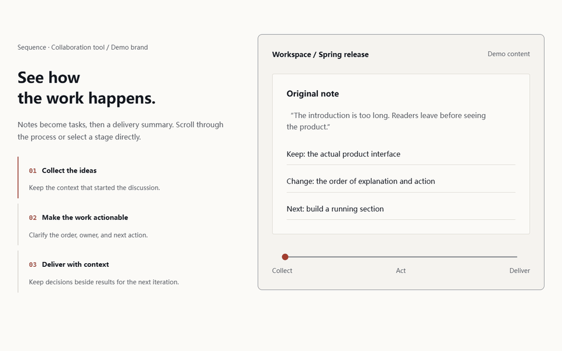

# Frontend Studio · 前端工坊

**把排版建立起来，把创意组件做出来，把动态效果跑起来验收。**

这是用于新建、改造和审查前端的 agent skill，特别关注中文与中英文混排。先确定内容和用途，再观察参考、选择自己的组件机制，最后运行、截图和验证。

[English](README.md) · [英文技能正文](frontend-studio/SKILL.md) · [验证与边界](docs/validation.md)



*由自带样例的实际浏览器动画帧合成。品牌和数据是演示内容；它们是机制原型，不是生成效果排名或真实客户项目。*

## 安装到 Codex

当前 skills CLI 要求 Node 22.20+。

```bash
npx skills add impossible87/frontend-studio --skill frontend-studio -g -a codex
```

安装后新开一个 Codex 对话，输入：

```text
用 $frontend-studio 改造这个产品页。
保留现有框架、真实文案、路由和表单。
主动找参考，自行选择适合内容的动态组件，
在 1280/1536 宽度验证键盘、减少动态和快速切换。
```

也可以把完整 `frontend-studio/` 文件夹复制到用户技能目录，通常是 `~/.agents/skills/`。不要只复制 SKILL.md。已在 Codex 实测识别；其他支持 SKILL.md 的工具尚未验证。

## 它解决什么

- **文字角色统一**：展示、标题、正文、标签等共用一套 tokens；品牌、操作、阅读场景各有尺度起点；一个字体家族也可以完成好设计。
- **主动寻找创意**：新建、整页重设计和创意组件自动检索参考，区分观察和推断；两个构想自行比较选择，减少逐组件选型。
- **按内容改造组件**：滚动联动、原位展开重排、内容切换是机制入口，按主题选择；复用时改结构、内容、字体、交互和节奏。
- **验证动态运行**：三态、反向与快速操作、键盘、减少动态、初始化失败和清理都要有证据；静态检查不能代替浏览器判断。
- **保留项目事实**：先画像和计划，再改造；保留框架、真实内容、路由、表单和用户状态。

这不是统一外观的模板包，也不保证每次模型生成都达到相同水平。它提供流程、tokens、可运行样例和检查工具。

## 运行样例

在仓库根目录运行：

```bash
python -m http.server 8000
```

打开 `http://localhost:8000/frontend-studio/assets/examples/motion-lab.en.html` 查看英文动态样例，`motion-lab.html` 是中文版本；同目录 `typography-lab.html` 查看排版样张；`frontend-studio/assets/starters/static/index.html` 是静态起点。

面向全球的主入口和执行指南使用英文；动态样例提供中英两个版本，排版与起手样张保留中文，部分原有脚本诊断与代码注释也保留中文。本仓库没有打包自定义字体或第三方组件源码。

Node 22+ 下运行 `npm test` 和 `npm run check`。浏览器工具的可选依赖和命令见[工具指南](docs/tools.md)。本轮主要验证 1280/1536 桌面 Chromium；手机端、跨浏览器、屏幕阅读器、Lighthouse 和 Core Web Vitals 量化未验收，详情见[验证报告](docs/validation.md)。

欢迎提交具体失败案例、同文案对照和可复现的交互问题，见[贡献指南](CONTRIBUTING.md)。如果对你有用，可以给项目一个 Star；实际反馈同样有价值。

原创内容采用 MIT。外部资源保持各自许可，见 [LICENSE](LICENSE) 与[来源记录](frontend-studio/SOURCES.md)。
